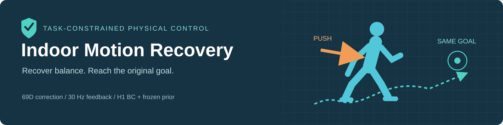
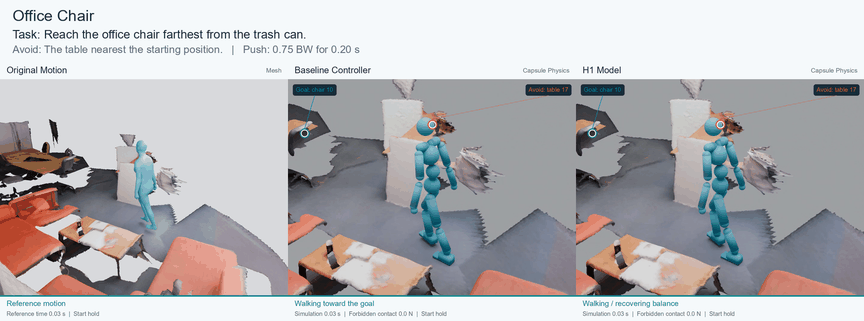
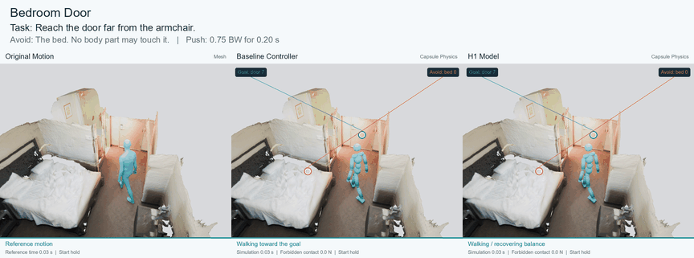
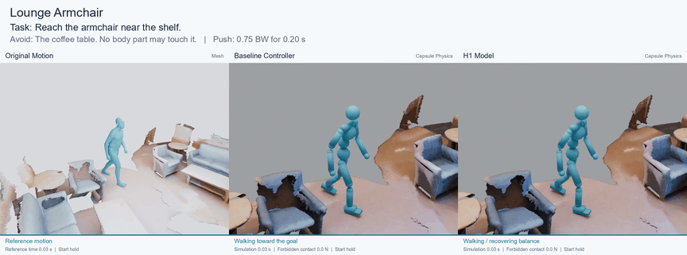
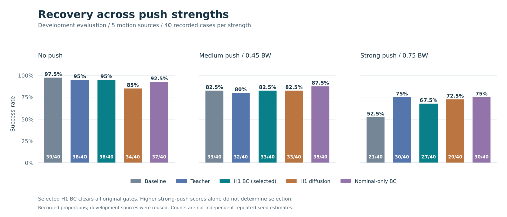
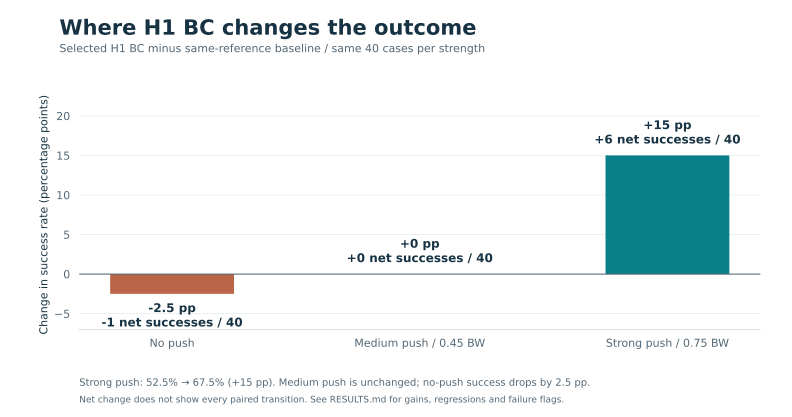
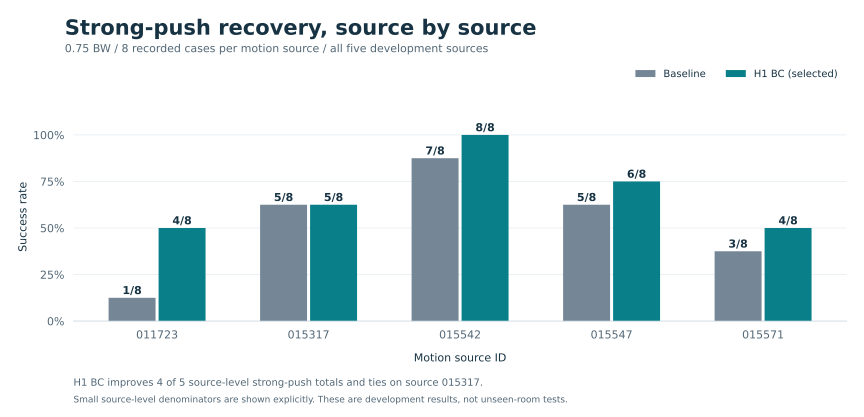

<p align="center">
  
</p>

<h1 align="center">🛡️ Indoor Motion Recovery</h1>

<p align="center">
  <strong>Recover from a push. Reach the original goal. Avoid forbidden contact.</strong>
</p>

<p align="center">
  <a href="https://github.com/BoPythonAI/Indoor-Motion-Recovery/actions/workflows/verify.yml"></a>
  
  
  
  
</p>

<p align="center">
  <a href="https://bopythonai.github.io/Indoor-Motion-Recovery/"><strong>▶ Watch the demos</strong></a>
  &nbsp;·&nbsp; <a href="docs/RESULTS.md">Results</a>
  &nbsp;·&nbsp; <a href="docs/METHOD.md">Method</a>
  &nbsp;·&nbsp; <a href="docs/SETUP.md">Setup</a>
  &nbsp;·&nbsp; <a href="https://github.com/BoPythonAI/Indoor-Motion-Recovery/releases/tag/v1.0.0">Downloads</a>
</p>

Task-constrained human motion recovery in scanned indoor scenes. A **single-step behavior-cloning policy** adds a **69-dimensional joint-control correction** to a frozen terrain-tracking prior, using current physics feedback and four frames of history. After a short push, the character must regain balance, reach the original target, and avoid touching a specified object.

**H1 means a one-step prediction horizon.** The simulated character is an SMPL humanoid; this project does not evaluate the Unitree H1 robot.

## At a glance

| Strong-push recovery | Original evaluation gates | Published demos |
|---|---|---|
| **67.5%** H1 BC vs **52.5%** baseline | **3/3** development + **3/3** validation | **3** scenes · **9** individual clips |
| **+15 percentage points**, 27 vs 21 successes / 40 | Selected checkpoint: frozen BC / EMA | Original Mesh · Baseline · H1 |

[Explore the charts ↓](#-results) · [Watch the demos ↓](#-three-demos) · [Reproduce the plots](docs/RESULTS.md#reproduce-the-figures)

## 🎬 Three demos

Every comparison shows **Original Motion · Mesh**, **Baseline Controller · Capsule Physics**, and **H1 Model · Capsule Physics**. Click a preview to open the video gallery.

### Office Chair

**Task:** reach the office chair farthest from the trash can. **Avoid:** the table nearest the start.  
**Outcome:** baseline falls without touching the table; H1 reaches the goal and stands stably.

[](https://bopythonai.github.io/Indoor-Motion-Recovery/#office_chair)

[Comparison MP4](docs/media/office_chair/comparison.mp4) · [Original Mesh](docs/media/office_chair/mesh.mp4) · [Baseline](docs/media/office_chair/baseline.mp4) · [H1](docs/media/office_chair/h1.mp4)

### Bedroom Door

**Task:** reach the door far from the armchair. **Avoid:** the bed.  
**Outcome:** baseline falls without touching the bed; H1 reaches the doorway and stands stably.

[](https://bopythonai.github.io/Indoor-Motion-Recovery/#bedroom_door)

[Comparison MP4](docs/media/bedroom_door/comparison.mp4) · [Original Mesh](docs/media/bedroom_door/mesh.mp4) · [Baseline](docs/media/bedroom_door/baseline.mp4) · [H1](docs/media/bedroom_door/h1.mp4)

### Lounge Armchair

**Task:** reach the armchair near the shelf. **Avoid:** the coffee table.  
**Outcome:** the baseline's **left hand hits the coffee table**; H1 reaches the goal without forbidden contact. The red alert marks the verified left-hand contact.

[](https://bopythonai.github.io/Indoor-Motion-Recovery/#lounge_armchair)

[Comparison MP4](docs/media/lounge_armchair/comparison.mp4) · [Original Mesh](docs/media/lounge_armchair/mesh.mp4) · [Baseline](docs/media/lounge_armchair/baseline.mp4) · [H1](docs/media/lounge_armchair/h1.mp4)

All three examples use a **0.75 BW push lasting 0.20 s**. English videos show every recorded frame at **0.5× speed**, with clearly labeled start/end holds. Frozen frames do not represent continued simulation after termination. These are selected failure-to-success examples, not a success-rate estimate.

## 📊 Results

Five development motion sources, **40 recorded cases per strength**, with the same reference, original goal, scene, and push protocol.



### What improves?



At strong push, H1 BC achieves **6 additional net successes out of 40**. At medium push the total is unchanged; without a push it has one fewer success. These are observed development proportions, not repeated-seed averages or statistical-significance estimates.

<details>
<summary><strong>View exact counts and all controller results</strong></summary>

| Controller | No push | 0.45 BW | 0.75 BW |
|---|---:|---:|---:|
| Same-reference baseline | 97.5% (39/40) | 82.5% (33/40) | 52.5% (21/40) |
| Scene-correction teacher | 95.0% (38/40) | 80.0% (32/40) | 75.0% (30/40) |
| **Selected H1 BC** | **95.0% (38/40)** | **82.5% (33/40)** | **67.5% (27/40)** |
| H1 diffusion | 85.0% (34/40) | 82.5% (33/40) | 72.5% (29/40) |
| Nominal-only H1 BC | 92.5% (37/40) | 87.5% (35/40) | 75.0% (30/40) |

</details>

H1 BC improves strong-push success by **15 percentage points** over the baseline and passes all original development and validation gates. Diffusion and the nominal-only control score higher on strong pushes, but miss the no-push gate. The selected model is not the best on every individual metric.

### Does the gain occur across sources?



The selected model improves four source-level strong-push totals and ties on the fifth. Source `015317` contains the office-chair demo: its selected failure-to-success clip does not imply a higher aggregate score for that source.

Validation: **16/16 at each strength** across two sources. Reserved motion `011387` in a known room: **8/8, 7/8, 7/8**, compared with baseline **8/8, 6/8, 4/8**. Development sources were reused during iteration; these results do not establish broad unseen-room generalization. [Full results and limitations →](docs/RESULTS.md)

[Download chart data (CSV)](docs/assets/charts/results.csv) · [Figure files (SVG / PNG)](docs/assets/charts/) · [Plotting script](tools/plot_results.py)

## 🧩 Pipeline

```text
Instruction + known scene instances
             ↓
Qwen relation parsing → goal / forbidden-object binding
             ↓
Goal-preserving reference + scene geometry
             ↓
Frozen terrain prior + H1 BC correction
             ↕
Physics state, contact and four-frame history
             ↓
Reach + stable standing + no forbidden contact
```

The Mesh column is the original kinematic reference, not an H1-generated reconstruction. Physics videos are rendered from actual recorded trajectories.

## 📦 What is included

| Path | Contents |
|---|---|
| `scripts_student_surface/` | BC/diffusion model, training, inference and dataset contracts |
| `scripts_teacher_planned/` | Original-goal task, scene geometry, physics evaluation and teacher runtime |
| `scripts_teacher_surface/` | Shared surface-control runtime |
| `scripts_surface_demo/`, `scripts_demo/` | Language-to-physics adapter and relation compiler |
| `configs/` | Five development configuration templates with explicit asset roots |
| `evidence/` | Evaluation summaries, frozen identities, source provenance and audited demo events |
| `docs/` | English project documentation and standalone video gallery |
| `tools/` | Release verification, configuration preparation and English demo rendering |

The [v1.0.0 release](https://github.com/BoPythonAI/Indoor-Motion-Recovery/releases/tag/v1.0.0) includes the selected checkpoint and original demo clips with rendering inputs. Raw ScanNet scans, HUMANISE motion banks, SMPL assets, and third-party pretrained priors must be obtained separately under their applicable terms.

## 🚀 Quick start

View the gallery locally without simulation dependencies:

```bash
git clone https://github.com/BoPythonAI/Indoor-Motion-Recovery.git
cd Indoor-Motion-Recovery
python -m http.server 8000 --directory docs
# Open http://localhost:8000
```

Verify the published files:

```bash
python tools/verify_release.py
```

For checkpoint download, offline training, asset requirements, and physical evaluation, see [Setup and reproduction](docs/SETUP.md). Model and video results are the frozen project results; the publication checks do not rerun GPU physics.

## Acknowledgments

Built around [ProtoMotions](https://github.com/NVlabs/ProtoMotions), [Isaac Lab](https://github.com/isaac-sim/IsaacLab), [HUMANISE](https://github.com/Silverster98/HUMANISE), [ScanNet](https://github.com/ScanNet/ScanNet), [SMPL-X](https://smpl-x.is.tue.mpg.de/), and [Qwen3-VL](https://github.com/QwenLM/Qwen3-VL). Dependency and asset terms remain with their respective owners. See [third-party notes](THIRD_PARTY_NOTICES.md).
